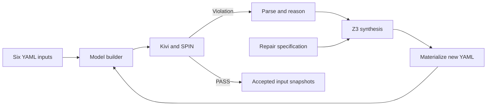

# Beek

Beek is a research prototype for repairing Kubernetes configuration fields with counterexample-guided inductive synthesis (CEGIS). It builds a Kivi model from YAML documents, verifies it with Kivi and SPIN, and asks Z3 for another assignment when verification finds a violation. Each proposed assignment is written to new YAML files, rebuilt, and verified again.

The supplied adapter covers the C3 family: one Deployment, three workers, hard node and zone spread constraints, a CPU-triggered HPA scale-up, and optional preferred zone affinity and node balance. Repair parameters are finite-domain integers with explicit YAML and model bindings. The two implemented reasoning rules apply only to a guarded C3 profile.

A `PASS` concerns the specified intents in the fixed model context, starting from the declared initial state. Beek returns configuration files; applying them to a running cluster requires a separate procedure. The core does not manage a rollout.

## Start here

These are importable Python modules. There is no Beek CLI or package installer in this tree. You need Python, PyYAML, Z3's Python bindings, GCC, and a writable [Kivi checkout](https://github.com/bingzheliu/Kivi) with its bundled SPIN executable. See [installation](docs/installation.md) for layout and checks.

The shortest tested path is the [complete quickstart](docs/quickstart.md). Run its Python block from this directory after setting the two shell variables. It creates an isolated C3_B5 input set and calls `run_beek_cegis`; no cluster is needed. In the documentation validation run it verified `(1,1)`, then `(2,1)`, then accepted `(1,5)`.

For a smaller C3 example, three workers initially hold `(2,1,2)` Pods in zones `(A,A,B)`. An HPA requests a sixth Pod after a CPU change. With both spread limits at 1, no worker is feasible. Scheduling can be repaired by raising either the node limit or the zone limit. With the cost objective and alphabetical tie-breaking, the next candidate is `(1,2)`. The extended cases also check balance, which can reject a scheduling repair.

## Documentation

| Task | Read |
| --- | --- |
| Prepare dependencies | [Installation](docs/installation.md) |
| Run a complete example | [Quickstart](docs/quickstart.md) |
| Understand the loop and modules | [Architecture](docs/architecture.md) |
| Understand validity, scope, and cost | [Repair model](docs/repair-model.md) |
| Write inputs and parameter bindings | [Inputs](docs/inputs.md) |
| Interpret verification and counterexamples | [Verification](docs/verification.md) |
| Understand Vault's two rules | [Reasoning](docs/reasoning.md) |
| Understand the SMT search | [Synthesis](docs/synthesis.md) 