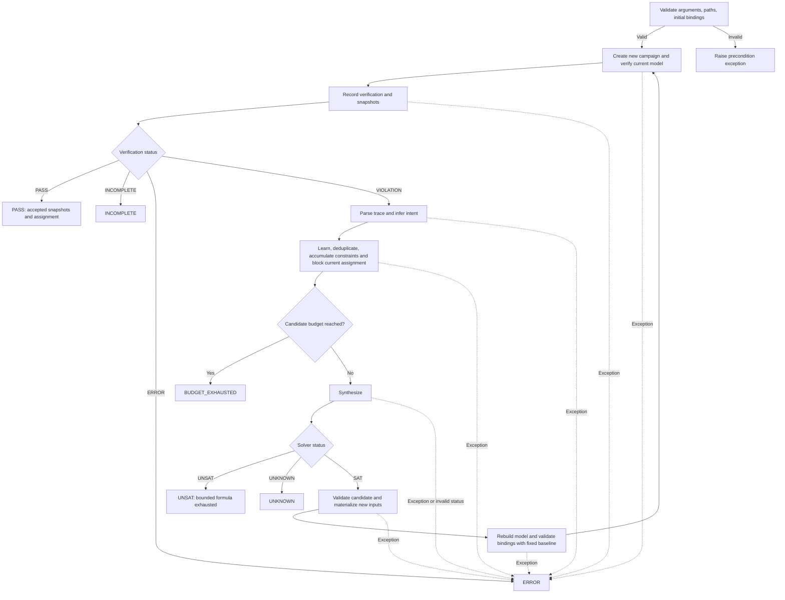

# Architecture

The [quickstart](quickstart.md) supplies functions explicitly to `run_beek_cegis`. The orchestrator owns campaign state and output paths; the callbacks build models, run Kivi, parse traces, build solver problems, synthesize assignments, and optionally learn constraints. Materialization and verification recording are called directly by the loop.

## Module map

| Module | Responsibility and callers | Scope |
| --- | --- | --- |
| [beek_cegis.py](../beek_cegis.py) | `run_beek_cegis` sequences all stages, checkpoints history, blockers, constraints, and outcome | General loop; fixed six-document/materializer contracts |
| [beek_model_builder.py](../beek_model_builder.py) | Builds the setup, invokes event compilation, and adapts `VeriferOperator` | C3-family model and Kivi integration |
| [beek_events.py](../beek_events.py) | Replaces model events from the catalog | CPU changes on one Deployment |
| [beek_repair_spec.py](../beek_repair_spec.py) | Resolves domains and YAML/model bindings before verification and after reconstruction | Integer fields |
| [beek_verification_artifacts.py](../beek_verification_artifacts.py) | Calls the verifier, intercepts subprocesses, classifies evidence, saves artifacts | Kivi-specific hooks and two recognized failures |
| [beek_verification_result.py](../beek_verification_result.py) | Checks metadata/model identity, resolves values, snapshots inputs | Six input names, versioned JSON record |
| [beek_synthesis.py](../beek_synthesis.py) | Parses text, constructs the repair problem, encodes constraints, calls Z3 | Finite integers and comparison/Boolean AST |
| [beek_reasoning_engine.py](../beek_reasoning_engine.py) | Selects engine and dispatches registered applicable rules | General dispatch interface |
| [beek_reasoning_rules.py](../beek_reasoning_rules.py) | Extracts guarded C3 context and generates scheduling/balance constraints | Bounded C3 profile |
| [beek_materialization.py](../beek_materialization.py) | Hash-checks snapshots, patches bound fields, publishes next inputs | Six documents and integer assignments |
| [beek_metrics.py](../beek_metrics.py) | Measures stages, evaluates finite constraints, aggregates diagnostics | No search decisions |

## Data and calls

The initial builder receives six paths and returns a dictionary with `setup`, `controllers`, `events`, and optional `intents`. The specification resolver reads the actual YAML and that model to produce `original`, `current`, `domain`, `binding`, and `model_binding` per parameter. These values are not taken from a case-name lookup.

`verify_and_save` wraps the supplied `verify_fn(model, root, case_id=...)`. `create_verification_result` consumes its artifact-path mapping without running verification again. A confirmed violation produces a parsed counterexample. Reasoning receives that counterexample, the current model, and parameter dictionaries reduced to `original`, `current`, and `domain`. The repair-problem callback receives accumulated learned constraints, all blocked complete assignments, and the resolved objective.

Z3 returns a candidate dictionary. The materializer receives the complete verification record and candidate, returns six new paths and provenance, and the builder receives those six paths in the same positional order as the initial build. `load_repair_spec` checks the reconstructed model against the new YAML and fixed original values before another verification.

## State machine

Ordinary runtime exceptions inside the loop become `ERROR` with a stage-qualified reason and `error_type`. Validation and campaign-directory creation happen before that handler and raise to the caller. A hard interruption can leave `RUNNING` and partial files. There is no resume API. Failure to write the final checkpoint can itself propagate an exception.

The candidate budget excludes the mandatory initial verification. Budget `N` permits at most `N+1` verification attempts. A `PASS` at iteration 0 accepts the original input. After a violation at the final iteration, parsing, reasoning, and blocking still occur, but synthesis does not; the outcome is `BUDGET_EXHAUSTED` even if a solver call might have found UNSAT. Counters increment before the verifier runs, so an exception can leave an attempt counted without a completed history entry.

All refuted assignments are blocked, including when reasoning is absent or skips every rule. Constraints persist across iterations and are deduplicated by `json.dumps(constraint, sort_keys=True)` of the entire record. Identical expressions with different provenance can remain separate constraints. Z3 itself is rebuilt on each call.

## Shared state and injection limits

Kivi uses cached Python modules, mutable `util.args`, a process-wide current directory, and shared generated files. The artifact wrapper also temporarily replaces `util.generate_dir` and `verifier_operator.run_script`, and redirects process output. Run campaigns one at a time against a dedicated checkout. Separate output directories alone do not make concurrent calls safe.

The callbacks permit an alternative builder, verifier, parser, synthesizer, or reasoner only if it satisfies the existing contracts. In particular, `verify_and_save` still imports and hooks Kivi even with a custom `verify_fn`; a wholly different verifier needs a matching artifact adapter or loop change. Materialization and result recording retain the six-document format. `reference_generator(3)` can inject controller dictionaries into the builder for reference comparisons, but the supplied Vault rules require empty controller option dictionaries.

See [API reference](api-reference.md) for signatures and [repair model](repair-model.md) for validity and termination conditions.
