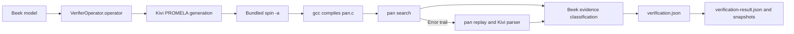

# Verification

`verify_kivi_model` in [beek_model_builder.py](../beek_model_builder.py#L375) passes a deep copy of the built model to Kivi's `VeriferOperator` (the class name has this spelling). It does not call Kivi's C3 generator to replace the supplied setup.

## Execution path



The adapter inserts `kivi_root/kivi` on `sys.path`, protects Kivi's first import from caller arguments with `sys.argv = ["kivi_runner.py", "-c", "c3", "-o"]`, and restores `sys.argv`. For the call it sets `original=True`, `simulation=False`, `all_violation=False`, `intents_group=0`, `random=False`, and `file_debug=0`, where those attributes exist. It restores their previous values afterward. Thus it checks one concrete setup, groups intents together, and stops at the first violation.

It changes the current directory to `kivi_root/bin`, calls `util.generate_dir(root, case_id, 3)`, constructs `VeriferOperator(..., case_id + "_3")`, and runs `operator()`. The `3` is the path/scale label for this three-node setup. It does not request an increasing-scale search.

Other options are inherited from Kivi's cached `util.args`. In the inspected checkout, defaults include `pan_compile="DVECTORSZ=100000, DT_RAND, DP_RAND"`, `pan_runtime="m100000"`, verbosity 1, and no explicit timeout. Setting `random=False` does not remove those compile-time randomization flags. The Beek callback does not expose a pan-options argument. Record the actual commands in `subprocesses.json` when comparing runs. The inspected operator can retry an insufficient depth with a larger bound; classification uses the last captured search. These details belong to the inspected Kivi revision and can differ in another checkout.

## Captured evidence

`verify_and_save` temporarily intercepts `util.generate_dir` to locate generated outputs and `verifier_operator.run_script` to record subprocess results. Commands whose executable basename is `spin`, `gcc`, or `pan` are captured. `pan` with an argument beginning `-r` is replay; other `pan` invocations are searches. A captured call must return a tuple/list of at least three items: success flag, stdout, and stderr. Other commands are not recorded. If a subprocess wrapper raises, that call has no completed observation.

The wrapper saves the original input model and its canonical SHA-256, Kivi stdout/stderr, native failures, reconstructed parser-compatible text, process streams, and generated directories. It restores hooks even when `verify_fn` raises. Exceptions during early imports or filesystem setup occur before this protected call and can leave only partial artifacts.

## Status rules

The artifact metadata uses `FAIL` for a confirmed counterexample; the structured verification record maps it to `VIOLATION`.

| Outcome | Actual branch |
| --- | --- |
| `INCOMPLETE` | No captured `pan_search` |
| `INCOMPLETE` | Any captured SPIN or GCC pre-stage has false `success` |
| `INCOMPLETE` | Last search stdout has no `errors: <integer>` count |
| `FAIL` / `VIOLATION` | Kivi failure count > 0 and last pan error count > 0 |
| `PASS` | No Kivi failures, last error count 0, last search `success` true, and no recognized truncation message |
| `INCOMPLETE` | Remaining conflicting or insufficient evidence |
| `ERROR` | `verify_fn` raised an ordinary exception; overrides the classification, records the exception, and re-raises after saving available diagnostics |

The confirmed-failure branch precedes the successful-search/truncation checks. A positive Kivi failure and pan error can establish a violation even if the search also reports truncation or a false search-success flag. That is evidence of a bad execution, without establishing that the search completed. Conversely, zero errors alone cannot establish `PASS`.

Recognized truncation text is `max search depth too small`, `VECTORSZ too small`, `out of memory`, `search truncated` / `search was truncated`, or `Search not completed`, checked in the last search's stdout and stderr. Error counts are read only from its stdout. This is a text-based adapter, not an independent proof checker.

The inspected Kivi `run_script` generally returns `True` after `communicate()` without checking the child return code; timeout handling returns `False`. Beek records that flag and does not add an OS return-code check. Its classification therefore also depends on Kivi's failure parsing and textual pan evidence. Compiler/SPIN diagnostics still need inspection if the recorded flag is misleading.

## Counterexample format

Only two failure families are inferred from native text: `Scheduler - no_feasible_node` / `No feasible node!` maps to `pod_always_schedulable`, and `checkBalanceNode` / the unbalanced-Pods message maps to `pod_balance_across_node`. Checked intents come from the last matching `Working on the intents:` stdout line, or a fallback built from the model and implicit schedulability. This inference is recorded as such; it is not a general intent parser.

Historical C3_B5 trace, manuscript Appendix B.2 (also reproduced in the documentation run):

```text
Counterexample:
[0][CPU Change] CPU change 3 on pod 2, now 11, and node 1, now 21
[1][HPA] Need to rescale, pod number change from 14 to 15
[2][Deployment] Too few replicas, need to create 1
[3][Deployment] Adding a new pod 15 to deployment 1
[4][Scheduler - no_feasible_node] No feasible node!

Summary:
    1 failure(s) found!
    Violating intent(s): pod_always_schedulable
```

`parse_counterexample` requires a line starting with `Violating intent(s):`, a `Counterexample:` marker, and at least one numbered `[index][component] description` line before `Summary:`. It returns:

```json
{
  "violated_intents": ["pod_always_schedulable"],
  "steps": [
    {"index": 0, "component": "CPU Change", "description": "CPU change 3 on pod 2, now 11, and node 1, now 21"},
    {"index": 1, "component": "HPA", "description": "Need to rescale, pod number change from 14 to 15"},
    {"index": 2, "component": "Deployment", "description": "Too few replicas, need to create 1"},
    {"index": 3, "component": "Deployment", "description": "Adding a new pod 15 to deployment 1"},
    {"index": 4, "component": "Scheduler - no_feasible_node", "description": "No feasible node!"}
  ]
}
```

Indices are integers; components and descriptions remain strings. The parser neither reconstructs variable valuations nor verifies consecutive indices. It uses the first counterexample section; this matches the supplied first-violation configuration. Unknown failures produce `unclassified` in the reconstructed summary and stop the campaign with `ERROR`. Recognized intent with an unsupported rule profile can still fall back to blocking.

`raw-trail.txt` is reconstructed report text, not a SPIN binary trail or byte-for-byte capture of a CLI session. `counterexample.native.txt` preserves `str_failures()`; `failures.json` preserves Kivi raw logs and details.

## Structured result and integrity

`create_verification_result` requires `beek.verification-artifacts.v1`, a recognized status, and a model SHA-256 equal to canonical JSON of the supplied model. `VIOLATION` additionally requires positive Kivi and pan counts; `PASS` requires both counts to be zero. It resolves every parameter against YAML/model fields, copies the six inputs plus specification, checks source and copy hashes, and records provenance as `beek.verification-result.v2`.

The raw report and metadata must share a run directory. These checks connect the artifacts, current parameter values, and next materialization. They do not independently rebuild the supplied initial model to prove every unbound YAML field matches it. Callers must build that model from the supplied inputs immediately before the run and keep the verification context fixed.

See [campaign artifacts](campaign-artifacts.md) for filenames and [troubleshooting](troubleshooting.md) for inconclusive runs.
